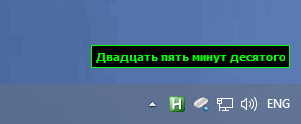

# Неточные часы (fuzzy clock)

Часы с точностью до пяти минут: «Без четверти два», «Половина третьего», «Ровно час». Точное время выводится во всплывающей подсказке.

Ремейк версии 2.1 от 12.01.2004 на Qt 6.



## Сборка

Требуется Windows, Qt 6 (модуль `widgets`) и MSVC.

Сборка либо в Qt Creator либо из командной строки msvs:

```bat
qmake fuzzy_clock.pro
nmake
```

Для запуска на другой машине необходимо скопировать библиотеки Qt в директорию с exe:

```bat
windeployqt fuzzy_clock.exe
```